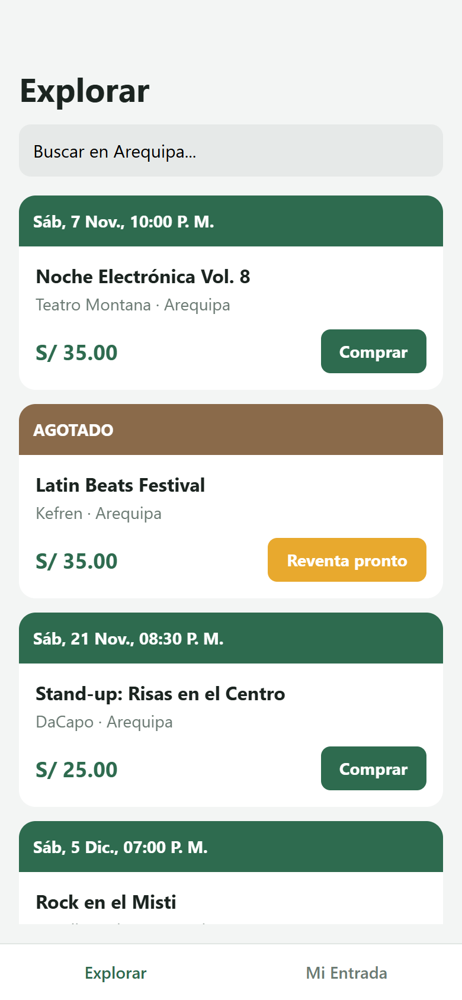
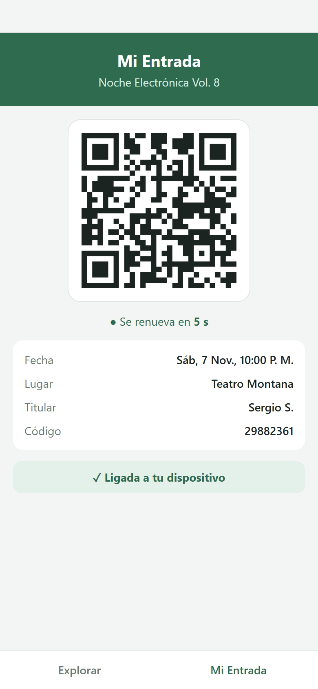
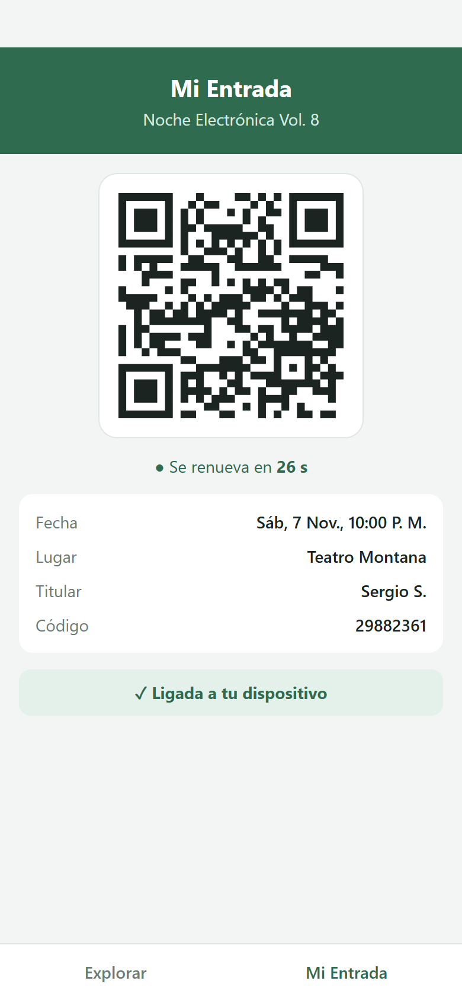

# Boletería Segura

Sistema de boletería y reventa segura con **QR rotativo**. Proyecto del curso Formación de Empresas de Base Tecnológica I (UCSP).

Equipo: Sergio Sirena Málaga · Diego Zeballos Cartagena · Nikolas Zuñiga Monroy

## Estado del avance (semana 1)

| Parte | Estado |
|---|---|
| API REST (Node.js + Fastify) | Eventos, compra simulada, QR rotativo y validación |
| Motor de QR (HMAC-SHA256, cambia cada 30 s, ligado al dispositivo) | Hecho, con pruebas |
| App móvil (React Native + Expo) | Pantallas *Explorar* y *Mi Entrada* |
| PostgreSQL + Prisma | Pendiente (hoy se usan datos de ejemplo en memoria) |
| Pagos (Mercado Pago / Yape) y escrow | Pendiente |
| Panel web B2B (Next.js) y lector en puerta | Pendiente |

## Capturas

| Explorar | Mi Entrada | 30 s después |
|---|---|---|
|  |  |  |

## Estructura

```
backend/   API en Node.js + Fastify
app/       App móvil en React Native + Expo
```

## Cómo ejecutarlo

Requisitos: Node.js 20 o superior.

### 1. Backend

```bash
cd backend
npm install
npm start        # API en http://localhost:3000
npm test         # pruebas del motor de QR
```

Endpoints:

| Método | Ruta | Qué hace |
|---|---|---|
| GET | `/events` | Lista eventos (filtros `?city=` y `?category=`) |
| GET | `/events/:id` | Detalle de un evento |
| POST | `/tickets` | Compra una entrada `{ eventId, holder, deviceId }` |
| GET | `/tickets/:id/qr?deviceId=` | Devuelve el token del QR vigente |
| POST | `/validate` | Valida un QR en la puerta `{ token }` |

### 2. App móvil

Con el backend corriendo, en otra terminal:

```bash
cd app
npm install
npm run web      # abre la app en el navegador
npm start        # o escanea el QR con Expo Go en el celular
```

Si pruebas desde el celular, cambia `API_URL` en `app/api.js` por la IP de tu computadora.

## Cómo funciona el QR rotativo

1. Al comprar, se genera una semilla secreta única para la entrada.
2. Cada 30 segundos la app pide un token nuevo: `idEntrada.ventana.firma`.
3. La firma es `HMAC-SHA256(semilla, idEntrada:idDispositivo:ventana)`.
4. En la puerta, el servidor recalcula la firma. Una captura de pantalla vieja ya no sirve y una entrada usada no se puede reutilizar.
