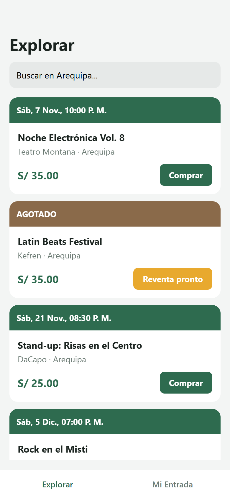
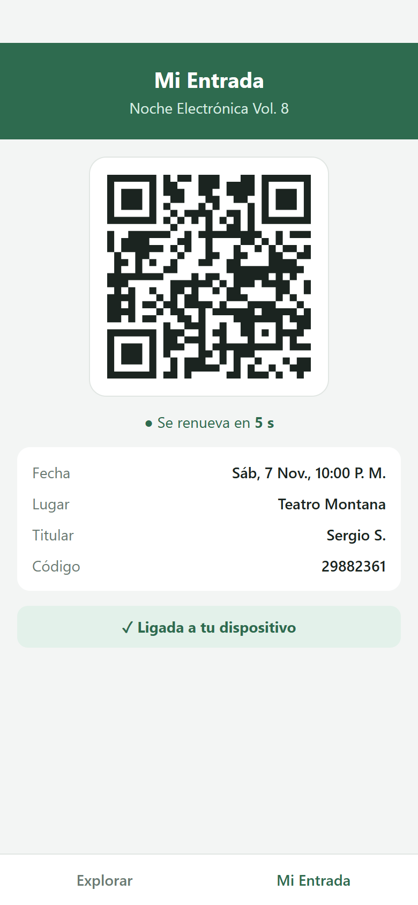
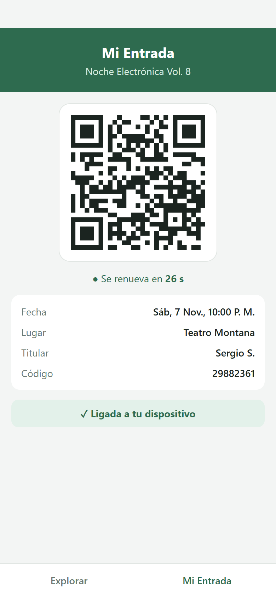

# Boletería Segura

Sistema de boletería y reventa segura con **QR rotativo**. Proyecto del curso Formación de Empresas de Base Tecnológica I (UCSP).

Equipo: Sergio Sirena Málaga · Diego Zeballos Cartagena · Nikolas Zuñiga Monroy

## Estado del avance (semana 3)

| Parte | Estado |
|---|---|
| API REST (Node.js + Fastify) | Eventos, compra, QR rotativo y validación |
| Base de datos (SQLite + Prisma) | Esquema con Event y Ticket, migraciones y seed |
| Motor de QR (HMAC-SHA256, 30 s, ligado al dispositivo) | Hecho, con 9 pruebas |
| App móvil (React Native + Expo) | Explorar, lista de entradas, detalle con QR |
| Lector en puerta (HTML + cámara) | Escanea QR y valida contra la API |
| Pagos (Mercado Pago / Yape) y escrow | Pendiente |
| Panel web B2B (Next.js) | Pendiente |

## Capturas

| Explorar | Mi Entrada | 30 s después |
|---|---|---|
|  |  |  |

## Estructura

```
backend/   API en Node.js + Fastify + Prisma
app/       App móvil en React Native + Expo
scanner/   Lector en puerta (HTML + cámara)
```

## Cómo ejecutarlo

Requisitos: Node.js 20 o superior.

### 1. Backend

```bash
cd backend
npm install
npm run db:setup    # crea la base de datos y carga los eventos
npm start           # API en http://localhost:3000
npm test            # 9 pruebas (4 del QR + 5 de integración)
```

Endpoints:

| Método | Ruta | Qué hace |
|---|---|---|
| GET | `/events` | Lista eventos (filtros `?city=` y `?category=`) |
| GET | `/events/:id` | Detalle de un evento |
| POST | `/tickets` | Compra una entrada `{ eventId, holder, deviceId }` |
| GET | `/tickets/:id/qr?deviceId=` | Devuelve el token del QR vigente |
| GET | `/tickets?deviceId=` | Lista las entradas de un dispositivo |
| POST | `/validate` | Valida un QR en la puerta `{ token }` |

### 2. App móvil

Con el backend corriendo, en otra terminal:

```bash
cd app
npm install
npm run web      # abre la app en el navegador
npm start        # o escanea el QR con Expo Go en el celular
```

Si pruebas desde el celular, cambia `API_URL` en `app/api.js` por la IP de tu computadora.

### 3. Lector en puerta

Abre `scanner/index.html` en el navegador del celular o de la laptop. Necesita cámara para escanear, o se puede pegar el token manualmente.

## Cómo funciona el QR rotativo

1. Al comprar, se genera una semilla secreta única para la entrada.
2. Cada 30 segundos la app pide un token nuevo: `idEntrada.ventana.firma`.
3. La firma es `HMAC-SHA256(semilla, idEntrada:idDispositivo:ventana)`.
4. En la puerta, el servidor recalcula la firma. Una captura de pantalla vieja ya no sirve y una entrada usada no se puede reutilizar.

## Base de datos

Usamos **SQLite** en desarrollo con **Prisma** como ORM. Para producción, el cambio a PostgreSQL es una línea en `schema.prisma`:

```prisma
provider = "postgresql"
url      = env("DATABASE_URL")  // postgres://...
```
